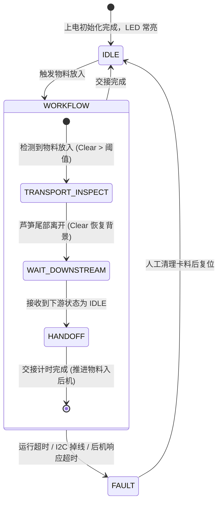

# ESP32 芦笋识别与进料推进单元 (head)

## 1. 系统定位与核心职责

本项目基于 **ESP32** 主控芯片，作为 thin_wall 流水线的 `head`（火车头）单元。
硬件架构采用**普通 ESP32 开发板 + TB6612FNG/DRV8833 直流电机 H 桥驱动 + 单颗 TCS34725 颜色传感器**。
当前版本暂不做横向直径测量与精确长度测量，重点实现芦笋进料感应、颜色特征识别、直流输送控制与向下游车厢（`body`）的数据交接。

> [!NOTE]
> `head` **仅负责物料感应、颜色判定与进料推进**，不执行等级评定与物理分选。定级与出料由下游 `body` 节点完成。

### 核心职责
1. **物料感知与进料推进**：待机时检测芦笋放入，控制直流电机平稳推进物料；
2. **颜色特征识别**：通过 TCS34725 颜色传感器识别物料颜色特征（绿色/白根/背景）；
3. **补光控制**：单路 LED 补光常亮，保证进料口检测光学基准稳定；
4. **背压互锁与数据交付**：物料尾部通过后暂停输送，确认下游 `body_1` 处于 `IDLE` 状态后再发包并推进交接。

---

## 2. 硬件架构组成

### 2.1 主控
- **MCU**: ESP32-WROOM-32 通用开发板（ESP32-DevKitC，双核 240MHz）。
- **废除配置**: 移除原 YoraHome CNC 三轴主板引脚与专用接线方案。

### 2.2 传感器系统
- **TCS34725 颜色传感器**:
  - 数量：1 颗；
  - 接口：硬件 I2C_0（SDA: GPIO 21, SCL: GPIO 22），I2C 地址固定为 `0x29`；
  - 积分时间与增益：`TCS_INTEGRATION_TIME` 默认 24ms，增益 `TCS_GAIN` 默认 4X；
  - **LED 补光控制**: GPIO 15 连接传感器模块 LED 控制脚，上电后保持常亮供电。

### 2.3 运动执行系统 (直流电机 + H 桥驱动)
- **电机类型**: 直流减速电机（用于流水线进料皮带/辊道传动）；
- **驱动模块**: TB6612FNG 或 DRV8833 双向 H 桥驱动；
- **控制引脚**:
  - `MOTOR_IN1_PIN` (GPIO 18) 与 `MOTOR_IN2_PIN` (GPIO 19)；
  - 采用 ESP32 LEDC PWM 发生器产生控制信号，实现平滑启停、调速与刹车制动：
    - 前进推进：IN1 输出 PWM，IN2 置 LOW（或根据接线逻辑配置）；
    - 停机/滑行：IN1 置 LOW，IN2 置 LOW；
    - 电子刹车制动：IN1 置 HIGH，IN2 置 HIGH。
- **废除配置**: 移除原 A4988 步进驱动、Y 轴丝杆测径电机、Y 限位开关与测径激光传感器。

### 2.4 电源系统
- 统一供电电源（如 12V 直流适配器）：
  - 12V 供 H 桥模块电机动力端（`VM`）；
  - 经 DC-DC 降压至 5V 供给 ESP32 开发板 `VIN/5V`；
  - 3.3V 由 ESP32 板载 LDO 输出供 TCS34725 传感器与逻辑引脚；全系统共地 (GND)。

---

## 3. 工作流程与运行机制

### 3.1 单料作业时序
```text
[进料口]
   │
   ├──> TCS34725 颜色传感器 (LED 补光常亮) ────> 直流皮带输送方向 ────> 下游 body_1
```

1. **待机检测 (IDLE)**:
   - 电机停止，补光 LED 常亮；
   - TCS34725 周期性采样 Clear 与 RGB 通道值；
   - 当 Clear 通道强度超出背景空载阈值时，判定物料放入。
2. **推进与颜色采集 (TRANSPORT_INSPECT)**:
   - 驱动直流电机以工作转速平稳前送；
   - 实时读取颜色值并判定主要颜色倾向（如绿色物料或白化变异）；
   - 维持单向输送直到传感器读数恢复为背景空载阈值（判定芦笋尾部已完全通过传感器工位）。
3. **背压监听与原地等待 (WAIT_DOWNSTREAM)**:
   - 尾部离开后，直流电机立即停机；
   - 监听数据串口 UART2 接收的下游状态包；
   - 若后机处于 `RECEIVING`、`SENDING` 或状态超时未到，电机保持静止原地等待。
4. **交接出料 (HANDOFF)**:
   - 检测到后机状态为 `IDLE` 时，通过 UART2 向下游发送物料判定数据包；
   - 启动直流电机运行预设交接时长（`HANDOFF_DURATION_MS`），将芦笋前推交付至下游 `body_1` 传送带；
   - 交接推进结束，电机停机，系统复位回到 `IDLE` 等待下一根放入。

### 3.2 双向通信与背压互锁规范
- 串口配置：UART2，波特率 115200；
- 引脚分配：TX2 = GPIO 17（发往下游），RX2 = GPIO 16（接收下游状态）；
- 调试输出：UART0 (GPIO 1 / GPIO 3) 供 USB 烧录与串口监视。

#### 下游心跳输入包 (RX)
由下游 `body_1` 每 50ms 周期广播：
```json
{
  "node": 1,
  "state": "IDLE"
}
```
状态枚举：`"IDLE"` (可接料)、`"RECEIVING"` (接收物料中)、`"SENDING"` (分选动作中)。

#### 本机测量输出包 (TX)
后机处于 `IDLE` 时发出的物料交付包（保持标准 JSON 字段兼容）：
```json
{
  "item_id": 1001,
  "color": "GREEN",
  "green_length_mm": 0.0,
  "diameter_mm": 0.0,
  "status": "OK"
}
```

### 3.3 异常保护
- **输送超时保护**：推进输送时间超过 `MAX_RUN_TIME_MS`（如 8000ms）仍未检测到尾部离开，强制停机并报 `FAULT_TIMEOUT`，防止卡料空转；
- **传感器异常保护**：I2C 通信连续失败超过预设次数，停机并报 `FAULT_SENSOR`；
- **下游通信超时**：物料到达出料位置后，若后机超过 `DOWNSTREAM_TIMEOUT_MS`（默认 5000ms）无 `IDLE` 响应，保持停机等待并打印报警。

---

## 4. GPIO 引脚分配表 (ESP32-WROOM-32)

| 功能分组 | 硬件功能 | 模块/设备 | ESP32 GPIO | 说明 |
| :--- | :--- | :--- | :--- | :--- |
| **I2C 传感器总线** | SDA / SCL | TCS34725 颜色传感器 | GPIO 21 / GPIO 22 | 硬件 I2C_0 总线，外接上拉电阻或模块板载上拉 |
| **补光控制** | LED_CTRL | TCS34725 模块 LED 引脚 | GPIO 15 | 高电平使能补光灯常亮 |
| **直流电机 H 桥** | MOTOR_IN1 | TB6612 / DRV8833 IN1 | GPIO 18 | ESP32 LEDC PWM 控制通道 0 |
| **直流电机 H 桥** | MOTOR_IN2 | TB6612 / DRV8833 IN2 | GPIO 19 | ESP32 LEDC PWM 控制通道 1 |
| **下行通信串口** | TXD2 | 级联总线发往 body | GPIO 17 | UART2 发送端 (115200 bps) |
| **下行通信串口** | RXD2 | 级联总线接收 body 状态 | GPIO 16 | UART2 接收端 (115200 bps) |
| **调试串口** | TXD0 / RXD0 | 电脑上位机 / USB 转串口 | GPIO 1 / GPIO 3 | 固件烧录与日志监控输出 |

---

## 5. 核心状态机架构



---

## 6. 关键参数定义预留

| 参数项 | 推荐值 | 单位 | 说明 |
| :--- | :--- | :--- | :--- |
| `MOTOR_PWM_FREQ` | 20000 | Hz | 直流电机 PWM 控制频率，避开人耳音频区 |
| `MOTOR_PWM_RES_BITS` | 8 | bit | PWM 分辨率 (0~255) |
| `MOTOR_SPEED_DEFAULT` | 200 | 0~255 | 默认送料推进 PWM 占空比 |
| `HANDOFF_DURATION_MS` | 1500 | ms | 物料离开传感器后继续推进交接的持续时间 |
| `MAX_RUN_TIME_MS` | 8000 | ms | 单次最大推料保护时间 (防卡料) |
| `BG_CLEAR_THRESHOLD` | 150 | - | TCS34725 背景物料判断阈值 |
| `DOWNSTREAM_TIMEOUT_MS`| 5000 | ms | 等待下游空闲超时上限 |
| `DATA_UART_BAUD` | 115200 | bps | 下行通信波特率 |

---

## 7. 软件构建与依赖

- **构建工具**: PlatformIO
- **核心框架**: Arduino Core for ESP32
- **依赖库**:
  - `adafruit/Adafruit TCS34725 @ ^1.4.4` (颜色传感器驱动)
  - `bblanchon/ArduinoJson @ ^6.21.3` (JSON 通信解析与打包)
  - `Wire` (ESP32 硬件 I2C 驱动)
