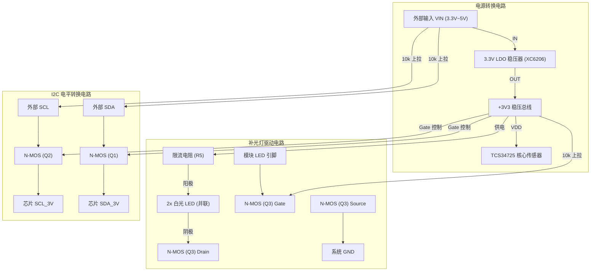

# TCS34725 颜色传感模块硬件参考手册与原理图分析

本文档说明市售双 LED 长条形 TCS34725 颜色传感器模块的电路原理图结构、供电拓扑、LED 驱动逻辑及引脚接线规范。

---

## 一、 电源拓扑架构

模块支持 3.3V ~ 5V 宽压输入，其内部电源流向如下：

```text
外部输入 VIN (3.3V ~ 5V)
    │
    ▼
[板载 3.3V LDO 稳压芯片 (XC6206 / RT9193)] ───► 输出核心稳定电压: +3V3
                                                      │
         ┌────────────────────────────────────────────┼───────────────────────────┐
         ▼                                            ▼                           ▼
[TCS34725 核心芯片 VDD]                   [补光 LED 限流电阻与阳极]      [I2C 电平转换低压参考端]
   (工作电压: 3.3V)                           (供电源: +3V3)               (Gate 端: 3.3V)
```

### 关键电气事实
1. **LED 供电节点**：
   - **补光 LED 的阳极连接在板载 LDO 稳压后的 `+3V3` 网络上**，而不是稳压前的 `VIN`。
   - 补光灯的工作电压与电流不受外部输入电压（无论是 5V 还是 3.7V~5V 波动）的影响，保证了照明色温与光通量的一致性。
2. **VIN 与 3V3 引脚关系**：
   - **VIN**：输入端，接入 3.3V ~ 5.0V。接 5V 时 LDO 正常降压工作。
   - **3V3**：LDO 输出端兼 3.3V 核心节点。
     - 当从 VIN 供电时，3V3 引脚为稳压输出（可向外输出微安/毫安级电流，通常悬空）。
     - 若系统只有 3.3V 供电，亦可直接将 3.3V 接至 3V3 引脚（VIN 悬空）。

---

## 二、 补光 LED 驱动电路原理

模块板载 2 颗贴片白光 LED，采用低端 N 沟道 MOSFET 开关驱动。

### 1. 电路拓扑图

```text
       +3V3 (稳压后 3.3V)
         │
         ├───[ 限流电阻 R5 (典型值 15Ω ~ 100Ω) ]
         │       │
         │       ▼ 阳极 (Anode)
         │     ┌─────────┐
         │     │ LED1/2  │ (白光贴片 LED，并联连接，Vf ≈ 3.0V)
         │     └─────────┘
         │       │ 阴极 (Cathode)
         │       ▼
         │     Drain (漏极)
         │   ┌───────┐
+3V3 ────┼───┤ Q3    │ N-MOSFET (如 BSS138 / 2N7002)
         │   │       │
[10kΩ R6]───┤Gate   │
         │   │       │
外部 LED ───┴───┤       │
控制引脚        └───────┘
                 │ Source (源极)
                 ▼
                GND
```

### 2. 控制逻辑与电气特性

| 状态 | 外部 LED 引脚输入 | MOS 管栅极电压 ($V_{GS}$) | MOS 管状态 | LED 状态 | 备注 |
| :--- | :--- | :--- | :--- | :--- | :--- |
| **悬空 / 未接** | 悬空 | 被板载 10kΩ 电阻上拉至 3.3V | 导通 ($V_{GS} \approx 3.3\text{V}$) | **常亮** | 默认出厂工作模式 |
| **输出高电平** | 3.3V 或 5V | 高于开启阈值 ($V_{th} \approx 1.3\text{V}$) | 导通 | **点亮** | 正常亮灯检测 |
| **输出低电平** | 0V (GND) | $V_{GS} = 0\text{V}$ | 截止 | **熄灭** | 关闭补光以省电或测环境底光 |
| **PWM 信号** | 0 ~ 3.3V PWM | 脉宽调制 | 高速开关 | **无级调光** | 推荐频率 1kHz ~ 20kHz |

---

## 三、 I2C 总线电平转换电路

模块板载双向 N-MOS 电平转换电路（基于 2 颗 BSS138 MOS 管），确保 5V 与 3.3V 系统双向通信安全。

```text
低压侧 (TCS34725 芯片)                           高压侧 (外部主控 MCU)
+3V3 ──[10k R1/R2]── SCL/SDA_3V                 VIN ──[10k R3/R4]── SCL/SDA (排针)
                          │                                         │
                          └─── Source         Drain ───────────────┘
                                   ┌─────────┐
                                   │ Q1 / Q2 │ N-MOS (BSS138)
                         +3V3 ─────┤ Gate    │
                                   └─────────┘
```

- 当外部主控为 5V（如 Arduino Uno）时，SDA/SCL 排针端上拉至 5V，芯片端被钳位在 3.3V；
- 当外部主控为 3.3V（如 ESP32）且 VIN 接 5V 时，由于 ESP32 引脚电平容限，建议 I2C 走线直接与 ESP32 内部上拉或 3.3V 匹配。

---

## 四、 完整模块原理图 (Mermaid 拓扑)



---

## 五、 与 ESP32 (`head`) 的推荐物理接线表

对应当前工程代码 [config.h](file:///d:/Software/thin_wall/head/src/config.h) 的定义：

| 模块排针引脚 | 对应连接目标 | 推荐接线方式 | 功能说明 |
| :--- | :--- | :--- | :--- |
| **VIN** | **ESP32 5V (VBUS / VIN)** | **接 5V** | 独立使用板载 LDO，隔离 ESP32 核心 3.3V 射频电源 |
| **GND** | **ESP32 GND** | **共地连接** | 电源与信号回路地 |
| **3V3** | *(悬空不接)* | 悬空 | 内部已稳压，无需外部输入 |
| **SCL** | **ESP32 GPIO 19 / GPIO 22** | 接主控 I2C 时钟 | 对应 `I2C_SCL_PIN` |
| **SDA** | **ESP32 GPIO 21** | 接主控 I2C 数据 | 对应 `I2C_SDA_PIN` |
| **INT** | *(悬空不接)* | 可不接 | 中断引脚，当前工程使用软件周期轮询 |
| **LED** | **ESP32 GPIO 15** | 接主控 IO | 对应 `LED_CTRL_PIN`，高电平点亮，支持 LEDC PWM 调光 |
